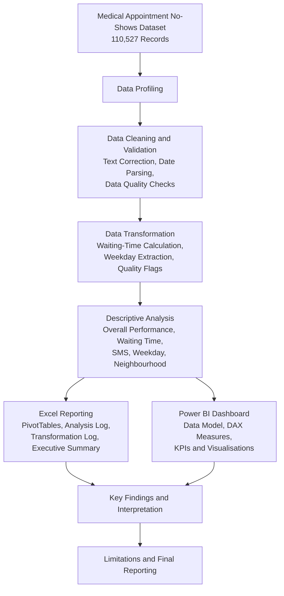

# Clinic Appointment Operations & No-Show Analysis

## Project Overview

An independent healthcare operations analytics project examining appointment attendance and missed appointments using the Medical Appointment No-Shows dataset (Brazil, 2016).

The project uses Microsoft Excel for data preparation and descriptive analysis, and Power BI for interactive dashboard development.

## Business Problem

Missed appointments can affect clinic scheduling and operational efficiency. This project examines appointment attendance patterns to identify areas that may warrant further operational investigation.

## Project Objectives

- Measure appointment volume and attendance performance.
- Examine the relationship between scheduling lead time and missed appointments.
- Compare attendance patterns by SMS reminder status.
- Analyse weekday-level appointment attendance.
- Examine neighbourhood-level differences in appointment attendance.

## Tools Used

- Microsoft Excel
- Microsoft Power BI
- DAX
- PivotTables
- Data cleaning and validation
- Descriptive statistical analysis

## Project Workflow

## Key Findings

| Metric | Result |
|---|---:|
| Total appointments | 110,527 |
| Attended appointments | 88,208 |
| Missed appointments | 22,319 |
| Attendance rate | 79.81% |
| No-show rate | 20.19% |

### Additional Findings

- Median waiting time was 2 days for attended appointments and 11 days for missed appointments.
- The highest no-show rate across waiting-time groups was 34.15% for appointments scheduled 31–60 days in advance.
- Appointments with an SMS reminder recorded a 27.57% no-show rate, compared with 16.70% without a recorded SMS reminder.
- Friday recorded the highest no-show rate among weekdays with substantial appointment volume (21.23%).
- Santos Dumont had the highest no-show rate (28.92%) among neighbourhoods with at least 400 appointments.

## Power BI Dashboard

The dashboard presents appointment attendance KPIs and visual analyses of waiting time, SMS reminders, weekdays and neighbourhoods.

## Project Files

- **Power BI Dashboard:** Available in this repository (`.pbix`).
- **Dashboard PDF:** Available in this repository.
- **Dashboard Screenshot:** Available in this repository.
- **Analysis and Transformation Logs:** Available in this repository.
- **Complete Excel Analysis Workbook:** [Download the Excel workbook](https://docs.google.com/spreadsheets/d/1KCug11A8C0uB_gkPj69EgexxKrow7-4B/edit?usp=sharing&ouid=100522880507861760888&rtpof=true&sd=true)

## Dataset Source

Medical Appointment No-Shows dataset (Brazil, 2016).

[Kaggle – Medical Appointment No Shows](https://www.kaggle.com/datasets/joniarroba/noshowappointments)

## Limitations

- The analysis is descriptive and does not establish causal relationships.
- The observed SMS reminder association does not demonstrate that reminders increase missed appointments.
- Five records with negative calendar waiting times were excluded from waiting-time analysis only.
- Saturday had only 39 appointments, so its attendance rate should be interpreted cautiously.
- Neighbourhood comparisons use a minimum volume threshold of 400 appointments, selected for descriptive reporting rather than statistical validation.

## Conclusion

The analysis identifies differences in appointment attendance across scheduling lead times, SMS reminder status, weekdays and neighbourhoods. These findings provide descriptive operational insights but should not be interpreted as evidence of causation.

---

**Project type:** Independent academic/portfolio project  
**Domain:** Healthcare Operations Analytics
